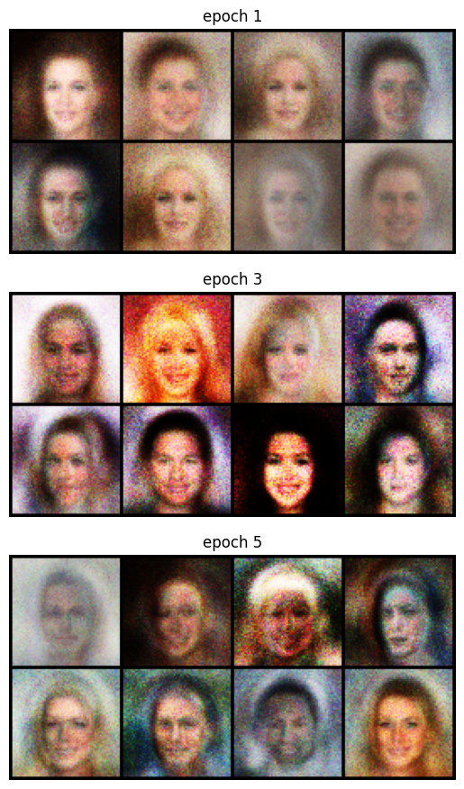
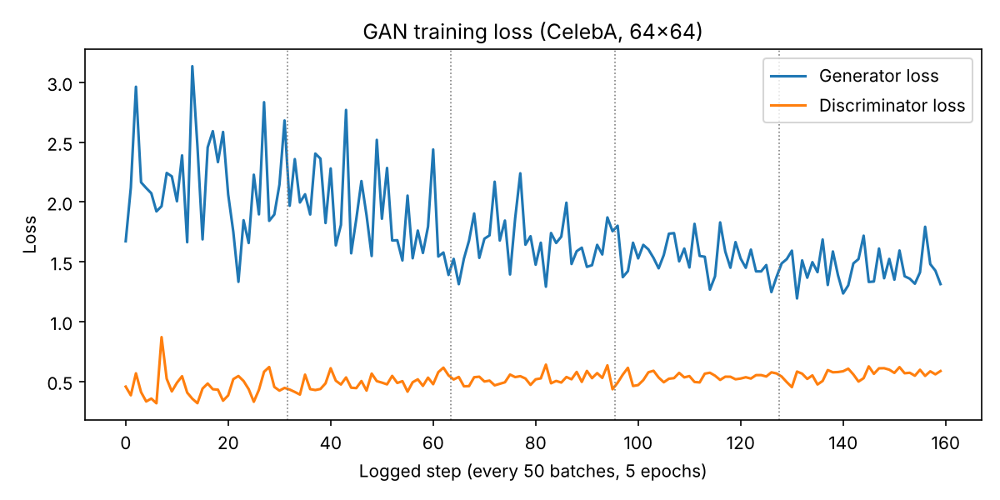

# GAN on CelebA (PyTorch)

A Generative Adversarial Network trained from scratch in PyTorch to generate 64x64 face images from the CelebA dataset. Training was done on Google Colab with a GPU.

## Results

Generated faces at epochs 1, 3 and 5 (8 samples per epoch, top to bottom):

Training loss (logged every 50 batches):

After 5 epochs the model generates blurry but recognizable faces. No quantitative image-quality metric (such as FID) was computed.

## Training Details

| Setting | Value |
|---|---|
| Dataset | CelebA, 202,593 images |
| Preprocessing | Center crop 178x178, resize 64x64, normalize to [-1, 1] |
| Generator | Fully connected: 100 -> 256 -> 512 -> 1024 -> 12,288, Tanh output |
| Discriminator | Fully connected: 12,288 -> 1024 -> 512 -> 256 -> 1, LeakyReLU, Sigmoid |
| Loss | Binary cross-entropy |
| Optimizer | Adam, lr 0.0002, betas (0.5, 0.999) |
| Epochs / batch size | 5 / 128 |
| Hardware | Google Colab GPU |

## Tech Stack

Python, PyTorch, torchvision, NumPy, Matplotlib, Pillow, Google Colab

## Dataset

The dataset is not included (about 1.2 GB). Download CelebA (aligned and cropped images) from https://mmlab.ie.cuhk.edu.hk/projects/CelebA.html and place the images in `img_align_celeba/`.

## Run

1. Open `GAN.ipynb` in Google Colab (set the runtime to GPU).
2. Make the CelebA images available at `./img_align_celeba`.
3. Run all cells. A grid of generated faces is shown after each epoch.

## Limitations and Next Steps

- Replace the fully connected networks with a convolutional (DCGAN) architecture for sharper images
- Train for more epochs
- Add a quantitative metric such as FID
- Save the trained generator and add a script to sample new faces

## Author

**Your Name**
[LinkedIn](https://www.linkedin.com/in/your-profile) | [GitHub](https://github.com/your-username)

Copyright (c) 2026 Your Name. All rights reserved.
